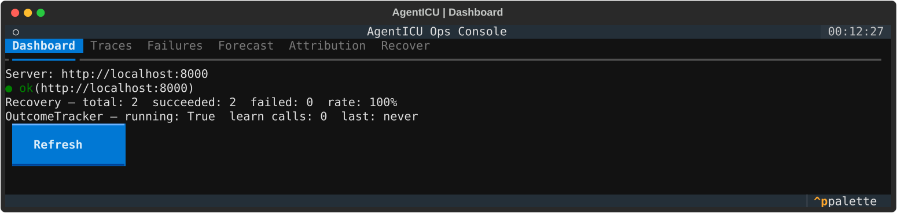
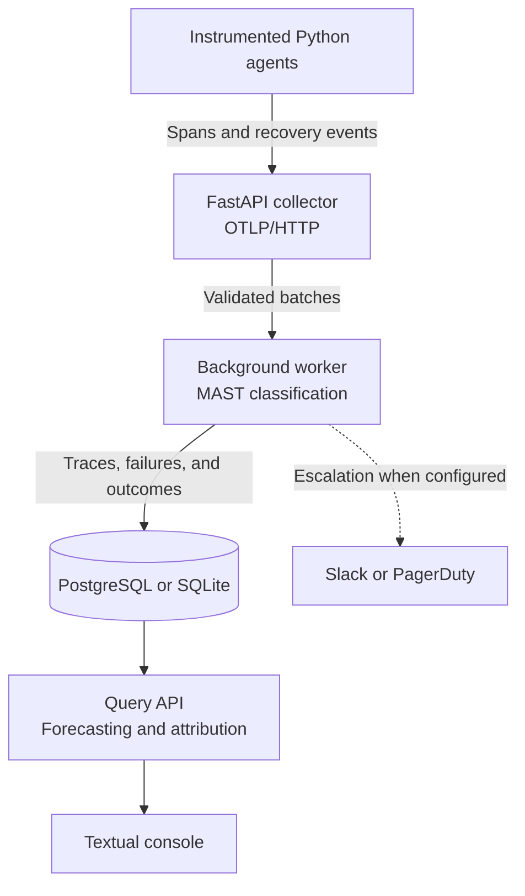
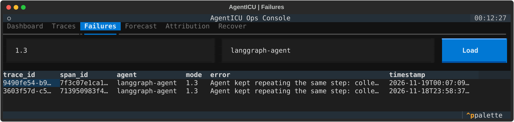
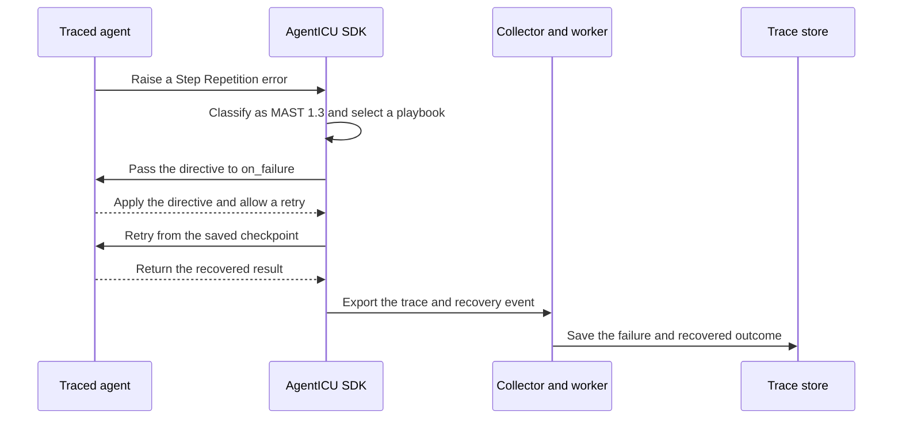

# AgentICU

**OpenTelemetry observability and recovery for multi-agent Python workflows.**

[](https://github.com/Anandhasasidharan/AGENTICU/actions/workflows/ci.yml)
[](https://pypi.org/project/agenticu/)
[](LICENSE)

AgentICU collects traces from agents, tool calls, handoffs, and decisions. When
an error matches one of its experimental MAST rules, an agent can receive a
recovery directive, apply it to its own state, and retry. AgentICU records the
outcome so you can inspect the original failure and the retry in one place.



## How it works



## Run the end-to-end demo

From a source checkout, use Python 3.11 or newer and Docker Compose.

```bash
git clone https://github.com/Anandhasasidharan/AGENTICU.git
cd AGENTICU
python -m venv .venv
source .venv/bin/activate
pip install -e ".[demo]"
docker compose up --build -d
curl --fail --retry 15 --retry-connrefused http://localhost:8000/health
python examples/langgraph_recovery_demo.py --server http://localhost:8000
```

The LangGraph agent repeats a completed step. The SDK hook applies the Step
Repetition directive and resumes the workflow from its checkpoint. The demo
verifies that MAST mode **1.3** and a **recovered** outcome are persisted in
PostgreSQL, then checks that the failure appears in the Textual console. It
runs with deterministic steps and requires no LLM API key.



The demo prints the trace ID. Open the console to inspect it yourself.

```bash
agenticu tui --server http://localhost:8000
```

## Instrument your agent

Install the SDK from this checkout with `pip install -e .`. Point your agent at
a running collector using `AGENTICU_SERVER_URL`. The SDK registers a batched
OTLP/HTTP exporter on the first traced call.

```python
from agenticu import tool_call, trace

@tool_call()
def lookup(topic: str) -> str:
    return f"Notes about {topic}"

@trace(agent_id="researcher")
def research(topic: str) -> str:
    return lookup(topic)

print(research("agent handoffs"))
```

Save the example as `my_agent.py` and run it against the API.

```bash
AGENTICU_SERVER_URL=http://localhost:8000 python my_agent.py
```

Use `@handoff` and `@decision` to capture transitions and decision results.
Applications with their own tracer provider can register
`AgentICUHTTPExporter` directly. Set `AGENTICU__API__KEY` in the agent
environment when the collector requires a bearer token.

### Apply a recovery directive

Pass `on_failure=callback` to `@trace`. The callback receives a
`RecoveryAction` with instructions, a target agent, and any available
playbook data. Apply it to your application's state before the next call.
Return `True` to retry, `False` to stop, or `None` to use the playbook's
recommendation. Supply a local `TraceStore` when a playbook needs access to
stored checkpoints. [Working LangGraph example](examples/langgraph_recovery_demo.py)

Use the recovery settings `auto_recover`, `max_retries`, and `escalate_after`
in the agent and server environments. With escalation configured, repeated
failures in the same mode can send the stored trace to Slack or PagerDuty.



## Run the collector

Docker Compose starts the API, PostgreSQL, Prometheus, and Grafana. A one-shot
migration job initializes the database before the API starts.

For local development without Compose, use SQLite.

```bash
pip install -e ".[tui]"
agenticu migrate
agenticu server
```

The default SQLite file is `agenticu.db`. Set `AGENTICU__STORAGE__SQLITE_PATH`
to choose another path. For PostgreSQL, install the `postgres` extra and set
`AGENTICU__STORAGE__DSN` for both migrations and the server. An empty DSN and
SQLite path select in-memory storage. Run `agenticu migrate` before the first
start and after upgrades that include schema changes. [Configuration](config.yaml) · [AWS deployment](infra/tofu/README.md)

The collector validates incoming batches and queues them for classification and
storage. A full queue returns HTTP 503. Accepted spans become queryable after
processing. The queue drains during graceful shutdown, and a crash can lose
batches still waiting in memory.

## Inspect traces and recovery outcomes

The terminal UI shows server health, traces, failures, handoff forecasts, and
attribution. Forecasts estimate risk from observed handoff outcomes.
Attribution uses trace evidence to suggest a likely upstream source of failure.
The Recover tab prepares a playbook directive for an operator.

| Method | Endpoint | Purpose |
| --- | --- | --- |
| POST | `/v1/traces` | Receive OTLP/HTTP traces in protobuf or JSON |
| POST | `/ingest` | Receive a debug batch such as `{"spans":[{"trace_id":"demo","span_id":"first"}]}` |
| GET | `/api/v1/traces` | List spans, optionally filtered by agent or status |
| GET | `/api/v1/traces/{id}` | Inspect the spans in a trace |
| GET | `/api/v1/failures` | List classified failures by agent or MAST mode |
| POST | `/api/v1/recover` | Prepare a recovery directive for a trace and mode |
| GET | `/api/v1/recovery-attempts` | List outcomes, optionally filtered by trace ID |
| GET | `/api/v1/metrics/recovery` | Read success rates by strategy and mode, with a flag below 50% |
| GET | `/api/v1/forecast` | Estimate failure probability for a source and target agent |
| GET | `/api/v1/forecast/trace` | Generate handoff forecasts for a stored trace |
| GET | `/api/v1/attribution` | Find a likely contributing agent for a failure span |
| GET | `/api/v1/outcome-tracker` | Inspect the forecasting update process |
| GET | `/health`, `/metrics` | Check server health and scrape Prometheus metrics |

## Classifier validation

**All 14 MAST classifier modes are experimental.** The best per-mode F1 was
**0.068** on the authors' 1,642 released traces with model-generated labels.
The benchmark classifies whole trajectories, while the live collector applies
the rules to individual error spans. The report includes a separate
human-labeled evaluation, per-mode scores, and the confusion summary.
[Validation report](docs/classifier-validation.md) · [MAST paper](https://arxiv.org/abs/2503.13657)

## Development

```bash
pip install -e ".[dev,tui,postgres]"
ruff check src tests docs
pytest
```

To include the live LangGraph test, start the Compose stack, install
`.[demo,dev]`, and run the suite with the server URL.

```bash
TEST_AGENTICU_COMPOSE_URL=http://localhost:8000 pytest
```

[Contributing](CONTRIBUTING.md) · [Changelog](CHANGELOG.md) · [MIT license](LICENSE)
